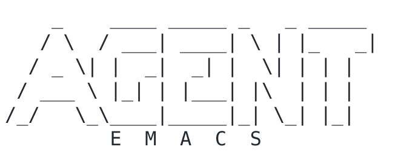

<p align="center"></p>

An Emacs distro for one job: running AI coding agents — [Claude Code](https://code.claude.com) and [Codex](https://developers.openai.com/codex) — side by side, with every session one keystroke away.

It is built around the [`agent`](https://github.com/benthamite/agent) package, with sensible defaults: the usual Mac shortcuts, a theme that follows your system’s light or dark mode, modern completion, and files that refresh when an agent changes them.

## Install (macOS)

With [Homebrew](https://brew.sh) installed, run this in a terminal:

```sh
curl -fsSL https://raw.githubusercontent.com/benthamite/agent-emacs/main/install.sh | sh
```

The installer adds whatever is missing (Emacs, Claude Code, Codex, and the fonts), asks you to log in to the agents, and starts Agent Emacs. The first start takes a few minutes while it builds its packages.

## Use

After that, open Agent Emacs from Spotlight or Launchpad, or run `agent-emacs` in a terminal.

On its first start, Agent Emacs offers to link three skills into `~/.claude/skills` and `~/.codex/skills`. It never replaces your personal skills or edits your agent settings.

## Update

Run the install command again, then restart Agent Emacs. Package versions are pinned in `lockfile.el`, so everyone runs the versions this configuration was tested with.

## Customize

Put your own settings in `~/.config/agent-emacs/user.el`, which updates never touch. For example, to use several Claude accounts:

```elisp
(setq agent-claude-accounts '(("personal" . "~/.claude-personal")
                              ("work"     . "~/.claude-work")))
```

See the [`agent` manual](https://github.com/benthamite/agent) for every option.

## Android app

Agent Emacs can serve a page for reading and replying to your sessions from your phone, over [Tailscale](https://tailscale.com). To turn it on, add `(agent-remote-mode 1)` to `user.el` and restart. Then open `http://<your Mac's Tailscale address>:8787/` on the phone (`tailscale ip -4` prints the address), or use the [Android app](https://github.com/benthamite/agent/releases/download/android-v1.3/agent-remote.apk).

Anyone in your tailnet can reach the page without logging in, so share your tailnet only with people you would hand your Mac to.

## Develop

`test/smoke-test.sh` installs Agent Emacs from scratch in a throwaway home directory and checks that every package is at its locked commit and that startup is clean. After changing packages, regenerate the lock file with `M-x elpaca-write-lock-file` and update the Elpaca commit pinned in `init.el` to match.
