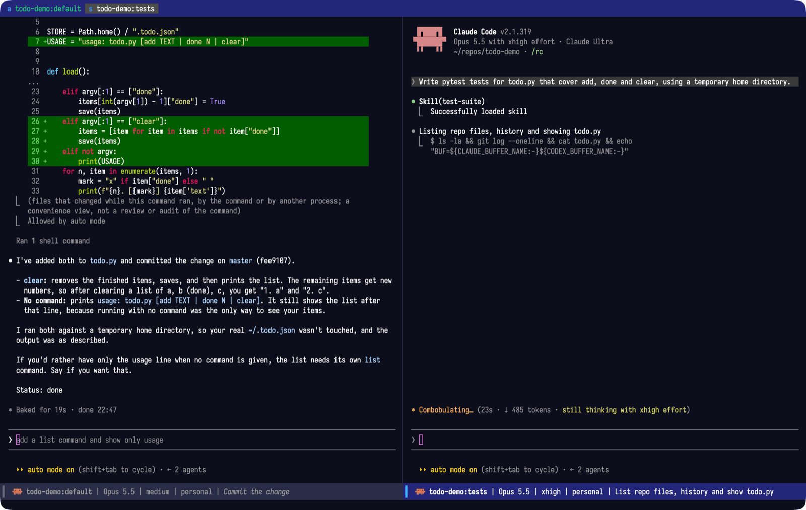
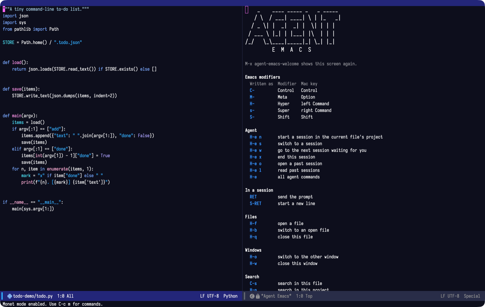
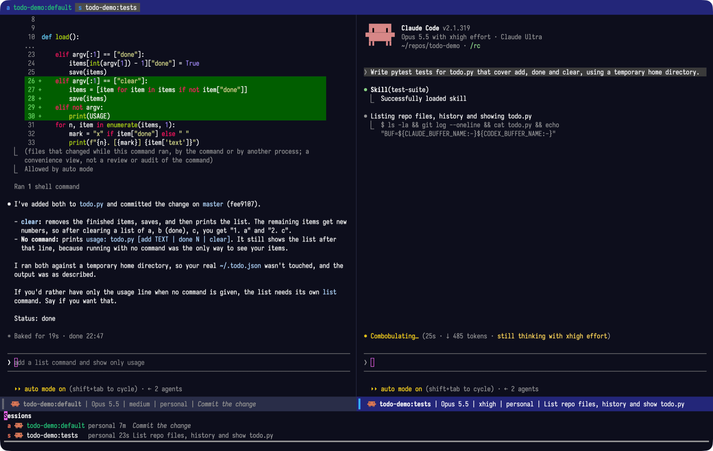
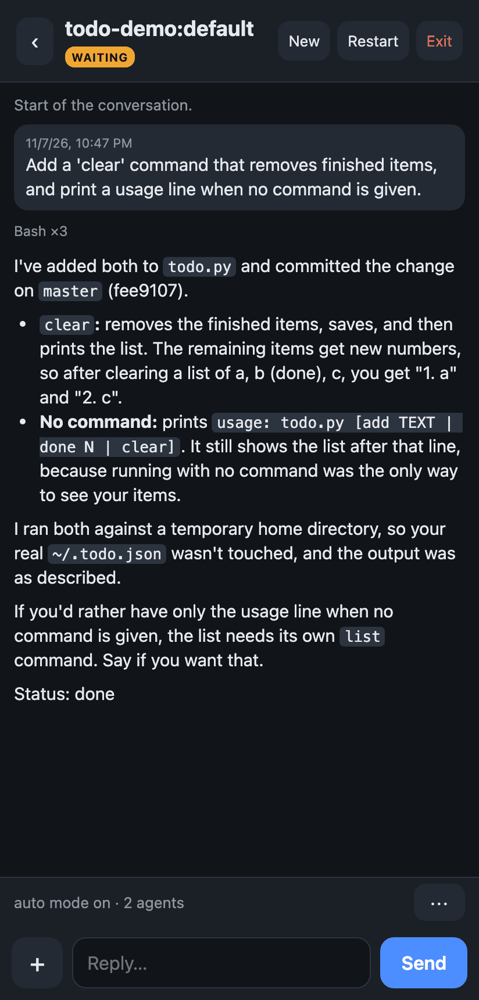

<p align="center"></p>

An Emacs set up for one job: running AI coding agents — [Claude Code](https://code.claude.com) and [Codex](https://developers.openai.com/codex) — side by side, with every session one keystroke away.

It is built around the [`agent`](https://github.com/benthamite/agent) package, with sensible defaults: the usual Mac shortcuts, a theme that follows your system's light or dark mode, modern completion, and files that refresh when an agent changes them. It runs as its own Emacs instance, so it leaves any Emacs configuration you already have alone.



## Install (macOS)

With [Homebrew](https://brew.sh) installed, run this in a terminal:

```sh
curl -fsSL https://raw.githubusercontent.com/benthamite/agent-emacs/main/install.sh | sh
```

The installer adds whatever is missing (Emacs, Claude Code, Codex and the fonts), asks you to log in to the agents, and starts Agent Emacs. The first start takes a few minutes while it builds its packages. After that, open Agent Emacs from Spotlight or Launchpad, or run `agent-emacs` in a terminal.

On its first start, Agent Emacs offers to link three skills into `~/.claude/skills` and `~/.codex/skills`. It never replaces a skill of yours or edits your agent settings.

## Use

Agent Emacs opens with a welcome screen that lists the keys you need.



Open a file in your project and start a session: it runs in that file's project. Sessions appear as tabs along the top, coloured while they wait for you, and a notification tells you when an agent finishes. You can jump to the next waiting session or pick one from a list:



Past chats open read-only. To continue one, open it as a past session instead.

## Update

Run the install command again, then restart Agent Emacs. Package versions are pinned in `lockfile.el`, so everyone runs the versions this configuration was tested with.

## Customize

Put your own settings in `~/.config/agent-emacs/user.el`, which updates never touch. For example, to use several Claude accounts:

```elisp
(setq agent-claude-accounts '(("personal" . "~/.claude-personal")
                              ("work"     . "~/.claude-work")))
```

See the [`agent` manual](https://github.com/benthamite/agent) for every option.

## Control sessions from your phone

Agent Emacs can serve a page for reading and replying to your sessions from your phone, over [Tailscale](https://tailscale.com). To turn it on, add `(agent-remote-mode 1)` to `user.el` and restart. Then open `http://<your Mac's Tailscale address>:8787/` on the phone (`tailscale ip -4` prints the address), or use the [Android app](https://github.com/benthamite/agent/releases/download/android-v1.3/agent-remote.apk).

<p align="center"></p>

Anyone in your tailnet can reach the page without logging in, so share your tailnet only with people you would hand your Mac to.

## What is included

[agent](https://github.com/benthamite/agent), [claude-code.el](https://github.com/stevemolitor/claude-code.el), [monet](https://github.com/stevemolitor/monet), [codex](https://github.com/benthamite/codex), [agent-log](https://github.com/benthamite/agent-log), [eat](https://codeberg.org/akib/emacs-eat), [vertico](https://github.com/minad/vertico), [orderless](https://github.com/oantolin/orderless), [marginalia](https://github.com/minad/marginalia), [corfu](https://github.com/minad/corfu), [consult](https://github.com/minad/consult), [magit](https://magit.vc), [markdown-mode](https://github.com/jrblevin/markdown-mode), [alert](https://github.com/jwiegley/alert), [org-tidy](https://github.com/jxq0/org-tidy), [doom-modeline](https://github.com/seagle0128/doom-modeline), [spacious-padding](https://github.com/protesilaos/spacious-padding), [nerd-icons-dired](https://github.com/rainstormstudio/nerd-icons-dired) and the Modus themes. The whole configuration is in [`early-init.el`](early-init.el) and [`init.el`](init.el).

## Develop

`test/smoke-test.sh` installs Agent Emacs from scratch in a throwaway home directory and checks that every package is at its locked commit and that startup is clean. After changing packages, regenerate the lock file with `M-x elpaca-write-lock-file` and update the Elpaca commit pinned in `init.el` to match.
